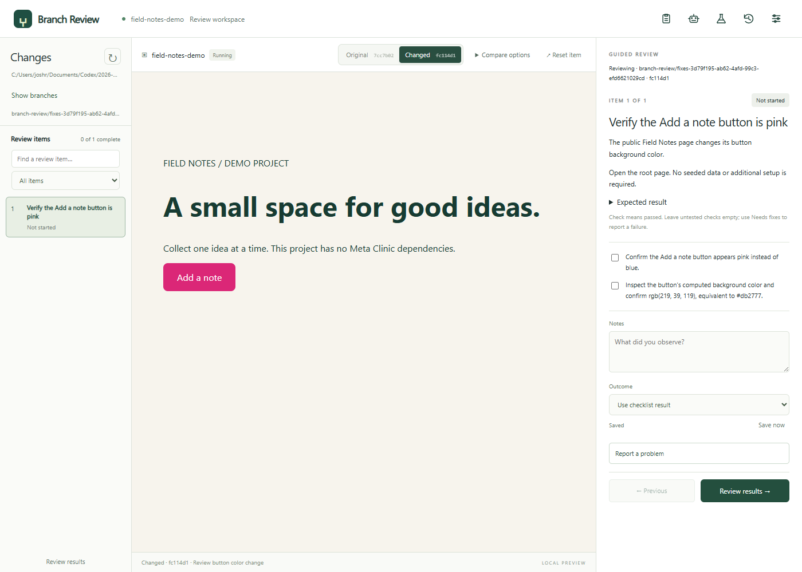

# Branch Review

A local desktop workspace for reviewing changes in Git projects: choose a branch, compare isolated versions, report findings, ask Codex for a fix, and retest within the same review.

**[Download the Windows beta](https://github.com/joshrice171723-creator/branch-review/releases/tag/v0.6.0)** · [Installation guide](INSTALL.md) · [Run from source](#get-started)

Actual Electron screenshot from the October 17, 2026 disposable Field Notes acceptance run: a blue button changed to pink, with the review checklist alongside it. The notes fields are empty and the project contains no patient records. This is a historical capture, not a mockup or a claim that the current live review passed. Current controls may differ. See the [capture procedure](test/renderer-smoke.cjs) and [recorded distribution evidence](DISTRIBUTION_AUDIT.md).

## Status and engineering

Active development. The public Windows 0.6.0 beta is unsigned and is an older snapshot than the current source. There is no hosted browser demo: previews run locally against a trusted Git project. Signing, automatic updates and clean-machine distribution acceptance remain separate work; see [distribution evidence](DISTRIBUTION_AUDIT.md).

The implementation separates review evidence from permission to ship. [Delivery](delivery.mjs) binds approval to a specific commit and refuses a moved default branch; an uncertain push is reconciled before another attempt. [Project delivery](project-delivery.mjs) requires an HTTPS receipt identifying the exact clean commit before reporting a deployment as published. Isolated previews preserve the original/changed comparison without treating a passing page check as complete product acceptance.

Built with Electron and JavaScript, with AI-assisted development using Codex. Generated checklists and fixes are inputs to human review, not a claim of autonomous correctness.

## Get started

Windows users: download the installer from the [public beta release](https://github.com/joshrice171723-creator/branch-review/releases/tag/v0.6.0) and follow [Install Branch Review](INSTALL.md). The beta is unsigned. Source setup requires Node.js 24 or later.

1. Open Branch Review.exe from its packaged folder, or run `npm ci`, `node node_modules/electron/install.js`, then `npm run desktop` from source.
2. Choose a trusted Git repository. Previewing executes project code. Git must be installed; generated checklists and fixes need an installed, signed-in Codex CLI or Claude Code.
3. The first-run **Set up your project** guide checks Git, your remote/default branch, commit identity, previews and your chosen agent. Resolve any flagged items, choose **Check again**, then **Start reviewing**. Reopen the guide from the **Settings** toolbar icon. Existing reviews stay available without repeating setup.
4. Choose a branch, or **Make changes** to start a new change from the remote default branch. The summary appears immediately; the combined result against the remote default branch, checklist and isolated previews prepare before QA.
5. Compare Original and Changed. Select an item or Next to open its screen, record observations and report problems.
   To request a change, right-click the affected area, describe what you want and click **Make changes**. The current page, version and cropped preview screenshot accompany the request. Drafts stay with their review. The separate **Review checklist** toolbar control edits testing instructions.
6. Send findings through **Updates & fixes**. Codex edits an isolated checkout; the host validates and commits the result. **Review fix** returns to the same review group with Before fix / After fix and unresolved findings ready to retest.
7. Finish the guided review, then choose **Send to QA**. Testing runs in the background. Open the flask-shaped **QA** icon to inspect results, approve a passed version, merge/push, and publish. Protected repositories can use **Workspace > Delivery > Create pull request**, with an authenticated GitHub CLI.

## Any project's setup

Projects are not restricted to Meta Clinic. Root npm Vite and Next projects with a package lock have automatic web previews. Other stacks, monorepos and service dependencies use a local recipe in **Workspace > Preview setup**. Install the project's required runtimes first.

Commands are executable-and-argument arrays, not shell strings. Configure the working directory, setup, start command, readiness path, optional services, environment and checks. Example Python server start: `["python","-m","http.server","{port}","--bind","127.0.0.1"]`.

Windows npm, pnpm and Yarn commands resolve their installed JavaScript entry points instead of trying to execute `.cmd` wrappers. Explicit JavaScript entry paths also work. Install the required manager first; custom preview recipes remain necessary for non-npm projects.

Placeholders: `{root}`, `{port}`, `{side}`, `{commit}`, `{data}`. Use `{data}` or revision-specific database names for isolated data. Branch Review cannot isolate an external database hardcoded by a project. Stop previews before editing their recipe. Recipe changes invalidate approval.

Generic previews use separate ports, retain recent healthy versions, reuse dependency setup and stop owned processes on exit. Meta Clinic keeps its existing adapter, data recipes and release integration. Generic projects require no Muse account, Office server or personal filesystem path.

Native/mobile apps and headless tools need an appropriate web harness to use the embedded preview. Configurable project support does not imply automatic knowledge of every build system.

## Activity and browser QA

The compact strip above the preview shows work and readiness. The **QA** navigation icon opens a full-page workspace with results and delivery controls. Logs stay under Technical details. **Watch browser** brings the current QA browser forward; it never steals focus automatically.

Opening a branch does not start QA. Complete your guided review and resolve findings, then choose **Send to QA**. You remain in Review while testing runs. The QA icon opens a separate page; Back to review preserves your preview. Its badge counts passed, current submitted reviews awaiting delivery. Superseded versions and old automatic runs do not count. The runner opens checklist routes and checks simple changed CSS properties on the active affected screen. Missing selectors remain unverified. Failed checks become findings with screenshots. Use **Run QA again** to retry deliberately.

The QA boxes show waiting, checking, passed, failed or unverified states. Select a box for evidence. The page states its coverage: page checks prove screens render, not that every requirement passes. The current run pins its preview; switching projects or replacing the runtime requires completing or stopping QA. You can return to the existing review without stopping it.

Evidence is ordered and pinned to the reviewed commit. Missing or interrupted results cannot become passes. Browser results do not approve manual items. General autonomous behavior discovery and generic hosted QA are not implemented. Muse hosted QA remains part of the optional Meta Clinic integration.

## Delivery

Git pushes never force-update the remote. A moved default branch requires reviewing a new candidate. GitHub pull requests retain repository protection rules and require `gh` authentication.

Configure a deployment executable/arguments and HTTPS build-receipt URL in Workspace. It runs only after the exact approved commit is pushed. Arguments support `{commit}` and `{root}`. The receipt must return JSON with `revision` equal to that commit and `dirty` false or absent. Command success without a matching receipt is not Published. Uncertain deployments require an inspection note before retrying.

Credentials and deployment setup belong to the project. No provider credentials are installed automatically.

## Storage and boundaries

Each project has local config, plans, reviews, evidence and worktrees. `BRANCH_REVIEW_HOME` overrides its data directory. Desktop project selection is stored in user-data. Config accepts `repository`, `previewRoot`, and optional `toolchain` for Meta Clinic's pinned package manager. `META_CLINIC_REPO` remains a compatibility override.

Checklists come from the actual diff and routes in a read-only checkout and stay outside project source. They are proposed testing instructions, not proof. Legacy checklist files cannot block candidate preparation; application conflicts still require resolution. Unrelated edits are preserved.

Codex jobs disable unrelated connectors, plugins, apps and hooks for that process without altering global configuration. Claude disconnected-state support remains; live Claude acceptance is deferred.

Loopback ports 4310-4312 are reserved. Only one controller can own them. The desktop renderer is sandboxed, and preview content cannot invoke privileged desktop controls. Running project commands is not an operating-system security sandbox.

## More tools

- **Review checklist:** edit proposed checks and routes; changes invalidate approval.
- **Updates & fixes:** findings, jobs, fix retesting and history.
- **Evidence:** screenshots, annotations, recordings and interaction replay.
- **Checks:** configured commands, accessibility and performance checks.
- **Published review:** existing Meta Clinic hosted-review integration.
- **Workspace:** repository, CLI diagnostics, preview setup and delivery.

Reports include outcomes, findings, screenshots, approval and delivery history. Old requests remain in history; save errors are visible.

## Development

`npm test` includes disposable Git repositories, actual custom-preview processes, provider protocol tests and browser-evidence validation. `npm run package:desktop` builds Windows x64. `npm start` provides the web UI; desktop capture and browser runs require Electron.

Meta Clinic's `npm run test:live` and `node test/qa-live.mjs` need their matching prepared preview pair. `npm run installer` creates the unsigned Windows x64 installer. The Windows installer workflow is configured for a fresh hosted runner, but account billing currently blocks it from starting. Signing and automatic updates remain separate distribution work. See [distribution evidence](DISTRIBUTION_AUDIT.md).
